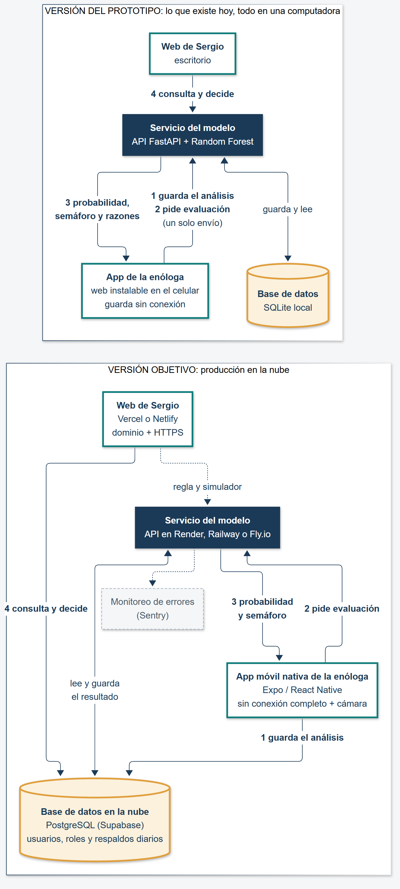
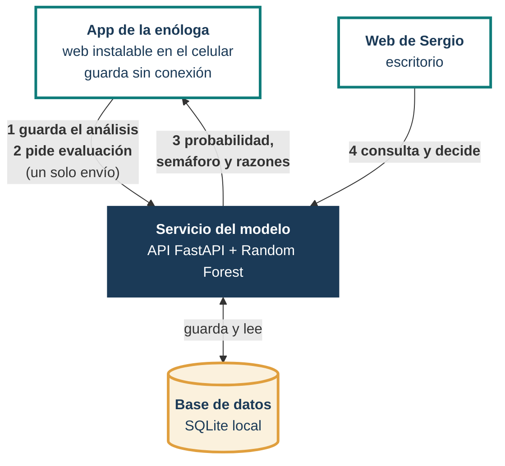
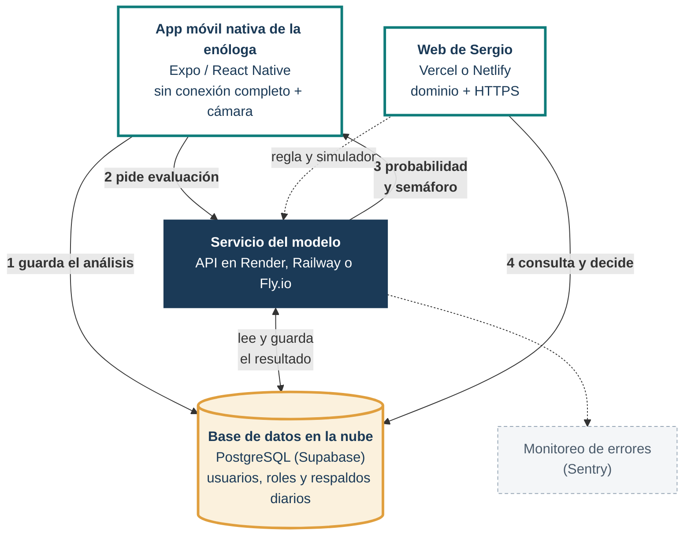

# Arquitectura de VinoScore

VinoScore tiene tres piezas que se hablan entre sí:

| Pieza | Qué hace | Quién la usa |
|---|---|---|
| **App de la enóloga** | Captura los 11 análisis de cada lote y muestra el resultado al instante | La enóloga, desde el celular |
| **Servicio del modelo (API)** | Corre el modelo, calcula el semáforo y las razones, y guarda todo | Las dos apps |
| **Base de datos** | Guarda lotes, análisis, predicciones, decisiones y la configuración | La API |
| **Web de Sergio** | Regla de decisión, lotes, ficha, decisiones y simulador | Sergio, desde la computadora |

Los **cuatro pasos** del flujo son los mismos en las dos versiones:

1. **Guarda:** la enóloga captura el análisis y se guarda en la base de datos.
2. **Pide evaluación:** la app le pide al servicio del modelo que lo evalúe.
3. **Probabilidad y semáforo:** el servicio responde con la probabilidad, el semáforo y las 3 razones.
4. **Consulta y decide:** Sergio ve los lotes y decide: Premium, Mandar a cata o Estándar.



> Versión vectorial: [`arquitectura.svg`](arquitectura.svg). El código fuente del diagrama está en [`diagramas/arquitectura.mmd`](diagramas/arquitectura.mmd).

## Versión del prototipo (lo que existe hoy)

Todo corre en una sola computadora, con una base SQLite. En el prototipo la app hace **un solo envío** (`POST /analisis`) que cubre los pasos 1 y 2: la API guarda el análisis, corre el modelo y devuelve el resultado (paso 3).



Para pasar a PostgreSQL basta con cambiar la variable `DATABASE_URL`: la API usa SQLAlchemy y no depende de SQLite.

## Versión objetivo (producción)

La app móvil nativa guarda en la base de datos en la nube (paso 1) y pide la evaluación al servicio del modelo (paso 2). Sergio consulta la misma base de datos desde la web (paso 4).



Los pasos para llegar ahí están en [`ruta_a_produccion.md`](ruta_a_produccion.md).

## Cómo volver a exportar el diagrama

El diagrama se exporta con [mermaid-cli](https://github.com/mermaid-js/mermaid-cli) (necesita Node.js y un navegador Chromium):

```bash
npx -p @mermaid-js/mermaid-cli mmdc -i docs/diagramas/arquitectura.mmd -o docs/arquitectura.svg -b "#F4F6F8"
npx -p @mermaid-js/mermaid-cli mmdc -i docs/diagramas/arquitectura.mmd -o docs/arquitectura.png -b "#F4F6F8" -s 2
```

Si `mmdc` no encuentra un navegador, instala Chromium o indícale uno con `-p puppeteer-config.json` (un archivo con `{"executablePath": "<ruta a chrome>"}`).
