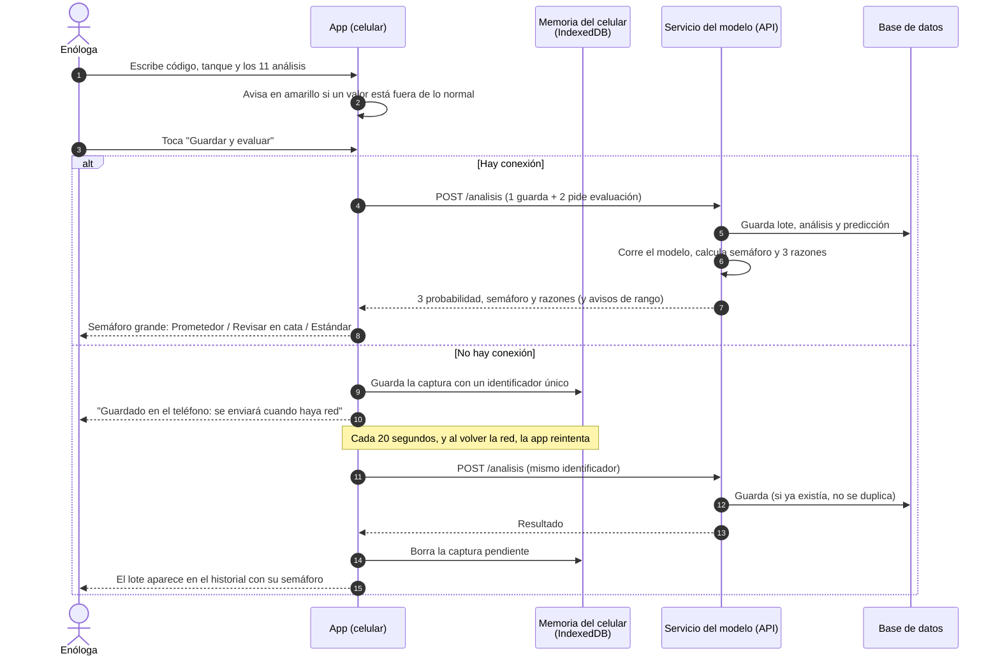
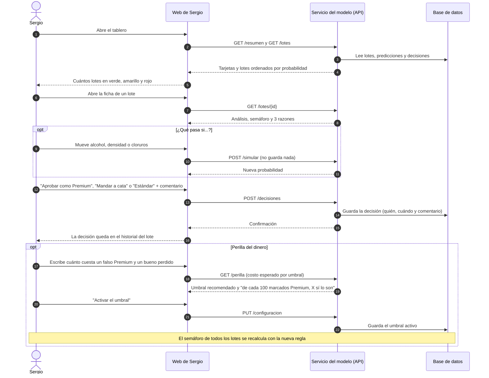

# Flujo de los usuarios

Dos personas usan VinoScore: **la enóloga**, que captura los análisis de cada lote, y **Sergio**, que decide qué lotes merecen trato premium. Los dos trabajan sobre la misma base de datos.

## La enóloga captura un lote (con y sin conexión)

## Sergio decide

## Qué significa cada color

| Semáforo | Palabras | Regla | Qué hacer |
|---|---|---|---|
| Verde | **Prometedor** | Probabilidad ≥ umbral activo | Buen candidato para el sello Premium |
| Amarillo | **Revisar en cata** | Entre 30 % y el umbral activo | Probarlo en cata antes de decidir |
| Rojo | **Estándar** | Menos de 30 % | Se ve como un vino estándar |

El umbral activo empieza en 0.5 y Sergio lo cambia con la perilla del dinero.
